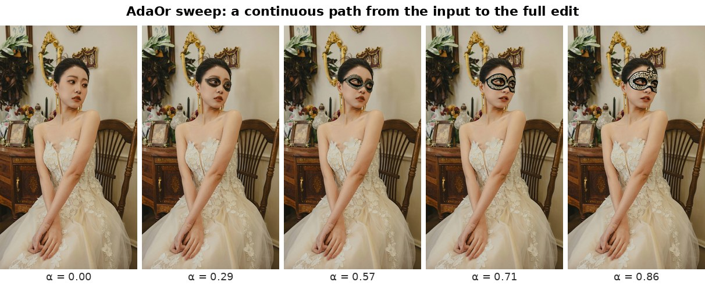
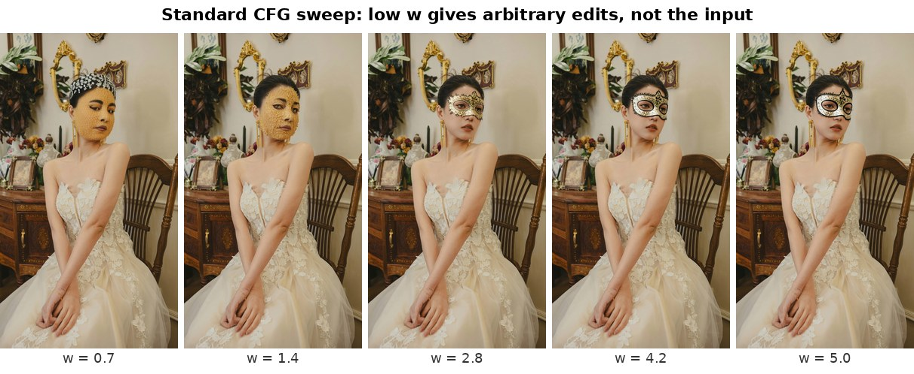

<h1 align="center">Continuous Control of Editing Models<br>via Adaptive-Origin Guidance</h1>

<p align="center">
  <a href="https://a1wo.github.io/">Alon Wolf</a><sup>1,2</sup> ·
  <a href="https://www.linkedin.com/in/chen-katzir-8549a6169/">Chen Katzir</a><sup>2</sup> ·
  <a href="https://kfiraberman.github.io/">Kfir Aberman</a><sup>2</sup> ·
  <a href="https://orpatashnik.github.io/">Or Patashnik</a><sup>1</sup>
</p>

<p align="center">
  <sup>1</sup>Tel Aviv University &nbsp;&nbsp;
  <sup>2</sup>Decart
</p>

<p align="center">
  <a href="https://arxiv.org/abs/2602.03826">
    
  </a>
  <a href="https://adaor-paper.github.io/">
    
  </a>
  <a href="https://research.decart.ai/adaptive-origin-guidance">
    
  </a>
  <a href="https://research.decart.ai/papers/adaptive-origin-guidance.pdf">
    
  </a>
  <a href="https://huggingface.co/decart-ai/Lucy-Edit-1.1-Dev">
    
  </a>
  <a href="LICENSE">
    
  </a>
  
</p>

<p align="center">
  <strong>Reference implementation of AdaOr — Adaptive-Origin Guidance</strong><br>
  A single continuous dial, <code>alpha ∈ [0, 1]</code>, for <em>how much</em> an
  instruction-based diffusion editing model edits.
</p>

<p align="center">
  
</p>

```bash
pip install -e ".[inference]"
adaor-sweep photo.jpg "make the hair blonde" -o outputs/blonde
```

That writes one frame per edit strength plus a `strip.png` contact sheet.

## 📚 Table of Contents

1. [The problem](#-the-problem)
2. [The method](#-the-method)
3. [Usage](#-usage)
4. [How the integration works](#%EF%B8%8F-how-the-integration-works)
5. [The identity instruction](#-the-identity-instruction)
6. [Backbones](#-backbones)
7. [Schedules](#-schedules)
8. [Ablation: REC in the steering term](#-ablation-rec-in-the-steering-term)
9. [Tests](#-tests)
10. [Repository layout](#%EF%B8%8F-repository-layout)
11. [Links](#-links)
12. [Citation](#-citation)

---

## 🧩 The problem

Editing models have no knob for *how much* to edit. Classifier-free guidance
looks like the obvious candidate — its scale `w` controls prompt adherence — but
sweeping it does not give a smooth transition from the input to the edited
result.

The reason is what sits at the bottom of the CFG equation:

```
eps^w  =  eps(z_t; c_I, null)  +  w * ( eps(z_t; c_I, c_T) - eps(z_t; c_I, null) )
          └──────── origin ────────┘      └──────────── steering ────────────┘
```

As `w → 0` the prediction collapses onto the **origin**, the null-instruction
prediction. In text-to-image generation that term means "any natural image". In
an *editing* model, conditioned on an input image, the null instruction means
"any edit" — not "no edit". So it projects the input onto a generic manifold of
edited images. Turning `w` down does not weaken the edit; it makes the edit
arbitrary. In the paper's examples, a brown bunny turns gray and a face gets
painted gold at low `w`.

<p align="center">
  
</p>

## 💡 The method

Replace the fixed origin with one that depends on the edit strength `alpha`.

Introduce an instruction `REC` that means the identity transformation, and
interpolate its prediction with the null prediction:

```
O(alpha)         =  s(alpha) * eps(z_t; c_I, null)  +  (1 - s(alpha)) * eps(z_t; c_I, REC)

eps^{w, alpha}   =  O(alpha)  +  g(alpha) * w * ( eps(z_t; c_I, c_T) - eps(z_t; c_I, null) )
```

`s` and `g` are monotonically increasing with `f(0) = 0` and `f(1) = 1`, which
gives the two boundary conditions that make the sweep continuous:

| `alpha` | reduces to | meaning |
| --- | --- | --- |
| `0` | `eps(z_t; c_I, REC)` | input preserved exactly |
| `1` | `eps(z_t; c_I, null) + w * (eps_text - eps_null)` | the backbone's default edit |

Everything in between interpolates between the two. The paper uses
`s(alpha) = sqrt(alpha)` and `g(alpha) = alpha`; both are the defaults here.

The whole rule is about twenty lines, in
[`src/adaor/guidance.py`](src/adaor/guidance.py). It uses only arithmetic shared
by `torch.Tensor` and `numpy.ndarray`, so it imports and unit-tests without
either installed.

## 🚀 Usage

### Sweep an image

```python
from adaor import sweep_edit

images = sweep_edit(
    "photo.jpg",
    "make the hair blonde",
    alphas=[0.0, 0.25, 0.5, 0.75, 1.0],
    guidance_scale=4.0,
)
```

One pipeline load and one prompt encoding are shared across the sweep, so this
is much cheaper than calling `edit()` in a loop. Every frame uses the same seed —
a varying seed would change content between frames and hide whether the
transition is actually smooth.

### Attach AdaOr to a pipeline you already have

```python
from adaor.pipelines import adaor_guidance
from adaor.pipelines.qwen_image_edit import QwenImageEditAdapter

adapter = QwenImageEditAdapter(image=source)

with adaor_guidance(
    pipe, adapter,
    instruction="make the hair blonde",
    rec_instruction="keep the image exactly the same",
    alpha=0.4,
    guidance_scale=4.0,
    call_kwargs={"image": source, "num_inference_steps": 50},
) as call_kwargs:
    image = pipe(**call_kwargs).images[0]
```

### Inspect the rule without a GPU

```bash
python examples/guidance_only.py
```

Prints the weight each prediction receives across the sweep, and how many
transformer passes each step costs.

## ⚙️ How the integration works

A diffusers pipeline computes CFG inside its own denoising loop. Subclassing it
means copying hundreds of lines that then rot against upstream; patching the loop
in place is worse.

So this repo wraps the **transformer** instead and neutralises the pipeline's own
CFG by pinning its scale to 1. The pipeline then makes a single transformer call
per step and uses the result directly as the noise prediction — and that one call
is where AdaOr runs its up-to-three predictions and combines them.

```
pipeline denoising loop  (untouched)
            │
            ▼
   AdaOrTransformer  ──────┬──── eps(z_t; c_I, null)
   (proxy)                 ├──── eps(z_t; c_I, REC)
            │              └──── eps(z_t; c_I, c_T)
            ▼
   adaptive_origin_guidance
            │
            ▼
      noise prediction
```

The pipeline keeps its scheduler, latent packing and image preprocessing. The
integration surface shrinks to one question — which keyword arguments carry the
text conditioning — which is all a backbone adapter has to answer. The proxy is
installed by a context manager that restores the original transformer on exit,
including when the pipeline raises.

**Cost.** Naively this is three forward passes per step instead of two. But a
prediction whose weight is exactly zero is skipped, so the endpoints cost two
passes, not three: `alpha = 0` needs only the identity prediction, `alpha = 1`
only the null and instruction predictions. Skipping is decided from the computed
weights rather than from `alpha`, so a custom schedule that does not vanish at
the endpoints stays correct.

## 🪞 The identity instruction

AdaOr needs a condition meaning "apply the identity transformation". Two ways to
get one:

**Prompt only** (default, no training). Condition on a plain instruction such as
`"keep the image exactly the same"`. Works with any off-the-shelf editing model,
and is the right way to check the mechanism before committing to a training run.
The identity prediction is only approximately the identity, so `alpha = 0`
reconstructs the input less exactly.

**Learned token** (what the paper does). Add a token to the text encoder's
vocabulary and train the editing model on identity pairs — identical source and
target images — paired with that token. The paper replaces about 10% of training
samples this way. This gives the cleanest `alpha = 0`, because the model has been
supervised to reproduce the input exactly.

```python
sweep_edit(..., lora_weights="qwen-rec-lora.safetensors",
           rec_instruction="<your-token>", trained_rec_token=True)
```

The token must match the one used at training time — a checkpoint trained with
one sentinel will not respond to another, so `resolve_rec_instruction` refuses to
guess rather than silently producing a meaningless identity prediction.
Vocabulary sentinels (`<extra_id_0>`) are the safest choice; rare
single-character tokens also work, and `adaor.find_rare_tokens` locates them.

## 🧠 Backbones

| Backbone | Status | Notes |
| --- | --- | --- |
| `qwen-image-edit` | supported | Public checkpoint, real CFG via `true_cfg_scale`. The most reproducible path. |
| `flux-klein` | supported, with a caveat | Guidance-distilled — see below. |
| Lucy-Edit | the paper's backbone | Weights are not public; the method is backbone-agnostic and the adapter interface is one small class. |

**FLUX.2 Klein is guidance-distilled.** It takes a guidance embedding inside the
transformer rather than running two forward passes, so out of the box there is no
classifier-free guidance for the steering term to build on. The adaptive origin
still applies — `alpha = 0` conditions on the identity instruction, `alpha = 1` on
the edit instruction, and the origin interpolates — but the steering term needs
real CFG with `true_cfg_scale > 1`, and a distilled model run with real CFG is
off-distribution. Expect to tune the scale well below what an undistilled
backbone wants. Setting `true_cfg_scale=1` gives origin interpolation alone,
which is stable and already produces a continuous sweep.

FLUX variants also differ in how many tensors `encode_prompt` returns and what
the transformer calls them, so the adapter infers the mapping instead of pinning
one spelling. `FluxKleinAdapter.describe()` reports what it inferred — the first
thing to check if results look wrong after a diffusers upgrade.

### Adding a backbone

Implement three methods and register the class in `adaor/pipelines/__init__.py`:

```python
class MyAdapter:
    backbone = "my-model"

    def condition_kwargs(self, pipe, prompt): ...   # encode -> transformer kwargs
    def disable_native_cfg(self, call_kwargs): ...  # pin the pipeline's CFG to 1
    def guidance_scale(self, call_kwargs): ...      # read w
```

## 📈 Schedules

| Name | `f(alpha)` |
| --- | --- |
| `sqrt` | `sqrt(alpha)` — the paper's origin schedule |
| `linear` | `alpha` — the paper's steering schedule |
| `square` | `alpha^2` |
| `cosine` | smooth ease-in/ease-out |

```bash
adaor-sweep photo.jpg "make it snow" --origin-schedule cosine --steer-schedule linear
```

### A note on two parameterisations

The paper puts the square root on the **origin** (`s(alpha) = sqrt(alpha)`) and
keeps the steering term linear (`g(alpha) = alpha`). A variant that circulated in
correspondence about the method does the opposite — mixes the origin linearly and
takes the square root in the steering term:

```python
noise_pred = (s * uncond + (1 - s) * identity) + sqrt(s) * w * (text - uncond)
```

Both satisfy the boundary conditions, so both give a valid sweep, but they trace
different paths in between and a sweep is **not** interchangeable between them.
The paper's version is the default. Reproduce the variant with:

```python
sweep_edit(..., origin_schedule="linear", steer_schedule="sqrt")
```

`python examples/guidance_only.py` prints both tables side by side; the variant
ramps the steering term much faster at low `alpha`.

## 🔬 Ablation: REC in the steering term

A natural question is whether the `REC` prediction can replace the null
prediction everywhere — as the origin *and* in the steering direction. The paper
shows it cannot. At the final denoising step the `REC`-conditioned distribution
collapses to the input, so

```
eps(z_t; c_I, REC)  ~  (z_t - c_I) / sigma_t
```

For a strong edit, `z_t` moves away from `c_I` while `sigma_t → 0`, so the
prediction's magnitude diverges — amplified further by the guidance scale. AdaOr
avoids this by conditioning the origin on edit strength: it relies on `REC` only
while the latent is still near the input, and hands the origin over to the
well-behaved null prediction as the edit strengthens.

Reproduce the unstable variant with `--steer-from-identity`.

## ✅ Tests

```bash
pip install -e ".[dev]"
pytest
```

73 tests, no GPU and no `torch` required. They cover the boundary conditions, the
affine-combination invariant, the forward-pass skipping, and the transformer
proxy against a fake pipeline.

## 🗂️ Repository layout

```
src/adaor/
├── guidance.py              the combination rule — the method, ~20 lines of maths
├── schedules.py             s(alpha) and g(alpha)
├── identity.py              resolving the REC instruction
├── sweep.py                 high-level sweep_edit() / edit()
├── cli.py                   adaor-sweep
└── pipelines/
    ├── base.py              transformer proxy + context manager
    ├── qwen_image_edit.py   Qwen-Image-Edit adapter
    └── flux_klein.py        FLUX.2 Klein adapter
```

Quantitative evaluation (PIE-Bench, slider baselines, metrics) lives in a
separate repository, released alongside the paper.

## 🔗 Links

| | |
| --- | --- |
| 📄 Paper | [arXiv:2602.03826](https://arxiv.org/abs/2602.03826) · [PDF](https://research.decart.ai/papers/adaptive-origin-guidance.pdf) |
| 🌐 Project page | [adaor-paper.github.io](https://adaor-paper.github.io/) |
| ✍️ Blog post | ["What if video editing had a volume knob?"](https://research.decart.ai/adaptive-origin-guidance) — Decart Research |
| 🎬 Backbone | [Lucy Edit 1.1](https://huggingface.co/decart-ai/Lucy-Edit-1.1-Dev) on Hugging Face |
| 👤 Author | [Alon Wolf](https://a1wo.github.io/) · [Google Scholar](https://scholar.google.com/citations?user=VLHXMrgAAAAJ) · [X](https://x.com/AlonWolfy) · [LinkedIn](https://www.linkedin.com/in/alon-wolf/) |

## 📝 Citation

If you find this work useful, please cite:

```bibtex
@article{wolf2026adaor,
  title   = {Continuous Control of Editing Models via Adaptive-Origin Guidance},
  author  = {Wolf, Alon and Katzir, Chen and Aberman, Kfir and Patashnik, Or},
  journal = {arXiv preprint arXiv:2602.03826},
  year    = {2026},
  url     = {https://arxiv.org/abs/2602.03826},
}
```

## 🙏 Acknowledgements

The example frames in this README are from the
[Decart Research post](https://research.decart.ai/adaptive-origin-guidance) on AdaOr
and were produced with [Lucy Edit](https://huggingface.co/decart-ai/Lucy-Edit-1.1-Dev).

## ⚖️ License

MIT — see [LICENSE](LICENSE).
